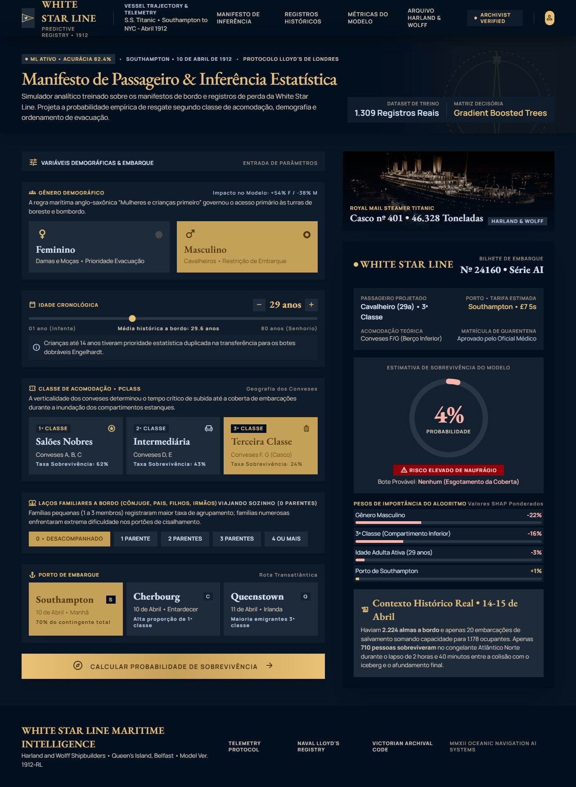

# Predição Titanic APP

Simulador web interativo que estima a **probabilidade de sobrevivência de um passageiro do RMS Titanic** com um modelo
de Machine Learning (Gradient Boosted Trees). O usuário preenche as características do passageiro e a probabilidade,
o medidor de risco e o peso de cada variável são recalculados em tempo real, direto no navegador.


| Desktop | Mobile |
| --- | --- |
|  |  |

<sub>Telas de referência do design system "Transatlantic Oceanic Registry".</sub>

## Destaques

- **Modelo real, inferência no navegador:** o GBT é treinado com scikit-learn, as 150 árvores são exportadas para JSON e
  percorridas em JavaScript, reproduzindo exatamente o `predict_proba` do sklearn, sem servidor.
- **Explicabilidade:** contribuição de cada variável em pontos percentuais (atribuição por caminho nas árvores, aproximação de SHAP).
- **Cenários contrafactuais:** cada opção do formulário mostra a probabilidade que o passageiro teria se ela fosse escolhida.
- **Design system próprio:** paleta, tipografia (EB Garamond + Manrope) e componentes definidos em [`design/DESIGN.md`](design/DESIGN.md), totalmente responsivo.

## Métricas do modelo

| Métrica | Valor |
| --- | --- |
| Acurácia (validação cruzada 5×) | 81,9% ± 1,6% |
| Acurácia hold-out (20%) | 79,3% |
| ROC-AUC | 0,838 |
| F1-score | 70,4% |

Variáveis: `Sex`, `Age`, `Pclass`, `FamilySize` (SibSp + Parch + 1) e `Embarked`.

## Estrutura

```
├── Titanic-Dataset-Modificado.csv   # dataset bruto (com ruído proposital)
├── modelo.py                        # análise exploratória, imputação por K-Means e SMOTE
├── ml/treinar_modelo.py             # treino do GBT e exportação para web/src/model/model.json
├── requirements.txt                 # dependências Python
├── web/                             # aplicação React + Vite + Tailwind
└── design/                          # design system (DESIGN.md) e telas de referência
```

## Como rodar

Requer Node.js 18+.

```bash
cd web
npm install
npm run dev        # http://localhost:5173
npm run build      # build de produção em web/dist/
```

## Python (modelo e análise)

Requer Python 3.10+.

```bash
python -m venv .venv
.venv\Scripts\activate          # Windows  (Linux/macOS: source .venv/bin/activate)
pip install -r requirements.txt

python ml/treinar_modelo.py     # retreina o GBT e atualiza web/src/model/model.json
python modelo.py                # estudo de pré-processamento (gera CSVs de treino/teste e scaler.pkl)
```

`modelo.py` é organizado em células `# %%`, que podem ser executadas uma a uma no VS Code ou Jupyter.
